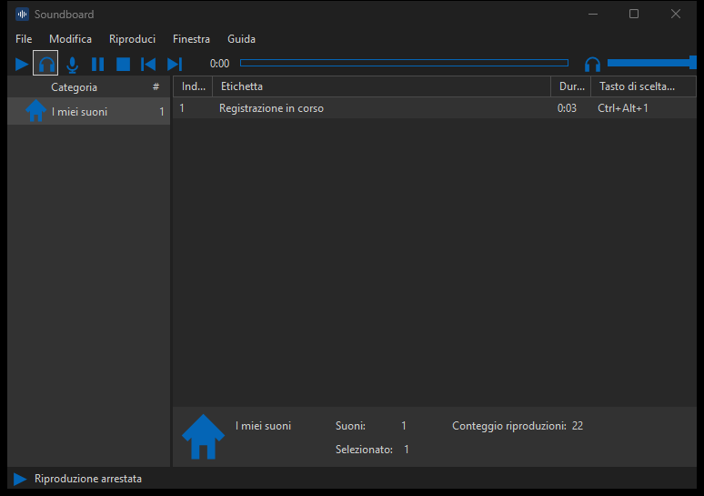

# Soundboard

**English** | [Italiano](README.md)

Windows application written in C# and Windows Forms to organize and play audio files, with a dark grey interface and blue controls. Sounds can be sent as a microphone to Discord and other calling apps through **Voicemeeter**.



The application interface is in Italian. Menu names are quoted below as they appear on screen, with an English translation in parentheses.

## Features

- Add audio and video files; import Soundpad `.spl` lists and compatible statistics.
- Play, pause, stop, seek and volume applied to the audio samples.
- Audio extraction from MP4, M4A, WAV, MP3, WMA, AAC, FLAC, OGG, Opus, MKV and WebM through FFmpeg.
- Missing file recovery and saving of library and preferences.
- Global shortcuts: `Ctrl+Alt+1` to `Ctrl+Alt+9`, and `Ctrl+Alt+F12` to stop.
- Output to speakers, to the Voicemeeter virtual microphone, or both.

## Using sounds in Discord with Voicemeeter

Soundboard plays files on the Voicemeeter virtual input. Voicemeeter mixes them with your real microphone and sends the result to a virtual output that Discord uses as its microphone. People in the call hear both your voice and the sounds.

```text
Real microphone --> HARDWARE INPUT 1 --(B)--> Voicemeeter Out B1 ---> Discord (input)
Soundboard -------> VIRTUAL INPUT ----(B)--/
                                      --(A)--> HARDWARE OUT A1 ---> headphones/speakers
```

Setup verified with Voicemeeter (standard edition) by [VB-Audio](https://vb-audio.com/Voicemeeter/), Discord and a USB microphone on Windows 11.

### 1. Voicemeeter

1. Install Voicemeeter and restart Windows if asked.
2. **HARDWARE INPUT 1**: select your microphone, preferably the `WDM` entry. Enable **B**, disable **A** so you do not hear your own voice.
3. **VIRTUAL INPUT** (Voicemeeter VAIO): enable **B**. Also enable **A** to hear the sounds on your headphones or speakers.
4. **HARDWARE OUT A1**: select your headphones or speakers from the **`MME`** entries. With `WDM` Voicemeeter can take exclusive control of the device: Discord and other apps can no longer play on it and you will not hear the other people.
5. Menu > **Run on Windows Startup**, so Voicemeeter starts with Windows. It must be running while you use Soundboard.

### 2. Soundboard

1. **Riproduci** (Play) menu: uncheck **Usa microfono fisico (APO Soundboard)** (Use physical microphone).
2. **Riproduci > Dispositivo microfono virtuale** (Virtual microphone device): select **Voicemeeter Input**.
3. Play with the microphone button (microphone only) or with **Riproduci file su altoparlanti e microfono** (Play file on speakers and microphone).

### 3. Discord

Settings > **Voice & Video**:

- **Input Device**: `Voicemeeter Out B1 (VB-Audio Voicemeeter VAIO)`.
- **Output Device**: your headphones or speakers (or `Default`).
- Turn off **Noise Suppression**: it treats the sounds as background noise and cuts them.

With Discord's mic test you should hear both your voice and the file being played.

### Troubleshooting

| Symptom | Cause | Fix |
| --- | --- | --- |
| Sounds are heard but not your voice | The microphone is not assigned to HARDWARE INPUT 1 | Select the microphone again on HARDWARE INPUT 1 and check that **B** is enabled |
| You cannot hear other people in Discord | HARDWARE OUT A1 in `WDM` holds the speakers exclusively | Select headphones or speakers from the `MME` entries |
| Sounds are choppy or missing | Discord noise suppression | Turn it off in Voice & Video |
| No sound at all in Discord | Voicemeeter closed or wrong Discord input | Start Voicemeeter and select `Voicemeeter Out B1` as input |

## Physical microphone through an APO (experimental)

The project also contains a path without Voicemeeter: a native APO (`native/`) that adds the file to the physical microphone stream. On the test PC, Windows 11 loads another vendor's signed APO at the same point of the audio chain, but **rejects our DLL because it is not signed**: the microphone can no longer be opened in shared mode. This path therefore remains experimental and needs a DLL with a valid digital signature. The installer script is `scripts/install-microphone.ps1`.

## Project layout

```text
Soundboard/
  src/          C# application sources
  native/       Experimental C++ APO and audio transfer protocol
  scripts/      Build, APO installer, logo generation and GitHub publishing
  assets/       Application logo and screenshot
  vendor/       Local decoder, licenses and dependency notes
  bin/          Compiled application with runtime dependencies
  research/     Evidence, tools and resources from the local analysis
```

`bin` and the evidence in `research` are excluded from Git. Sources, scripts, logo, screenshot and dependency notes are versioned.

## Build

Requirements:

- 64-bit Windows with .NET Framework 4.x and its C# compiler.
- Visual Studio Build Tools with the C++ compiler and Windows SDK, to build the native APO.
- A Windows build of FFmpeg from the [official site](https://ffmpeg.org/download.html), with `ffmpeg.exe` copied into the `vendor` folder.

From PowerShell in the project folder:

```powershell
powershell -ExecutionPolicy Bypass -File .\scripts\build.ps1
```

Run `bin\Soundboard.exe`. The build copies the decoder and its notes into `bin\vendor`: to move the application, copy the whole `bin` folder. Compiled binaries and the decoder are not included in the repository.

To generate the original logo:

```powershell
powershell -ExecutionPolicy Bypass -File .\scripts\generate-logo.ps1
```

## Local data

Library, settings and decoder cache are stored in `%LOCALAPPDATA%\Soundboard`. This data and personal audio files are not part of the repository. Temporary decoder files are removed on stop, cancellation or error.

## Verification

The Voicemeeter path was verified by hand: a tone played by the Soundboard player on `Voicemeeter Input` reaches `Voicemeeter Out B1` at the same level as the file, and in Discord voice, sounds and the other people are all heard.

## Dependencies and resources

The interface and logo are implemented in the project. The build does not embed Soundpad images or DLLs. Extracted files and local analysis evidence are excluded from the repository. Voicemeeter is a VB-Audio product and must be installed separately.

FFmpeg runs as a separate process. See [vendor/NOTICE.md](vendor/NOTICE.md) for origin, license and sources of the local distribution. Soundboard is an independent project and is not affiliated with Soundpad, Leppsoft, VB-Audio or Discord.

## Publishing to GitHub

From a regular Windows PowerShell, with GitHub access through the Git credential manager:

```powershell
powershell -ExecutionPolicy Bypass -File .\scripts\publish-github.ps1
```

The script creates the local commit, creates a public `Soundboard` repository in the authenticated account and pushes the `main` branch. Use `-RepositoryName Name` to choose the name and add `-Private` for a private repository. It never force-pushes and does not store credentials in project files or in the remote URL.

## License

Soundboard is released under the [MIT License](LICENSE). Contributions, issues and pull requests are welcome. FFmpeg remains under its own license (see `vendor/`).
